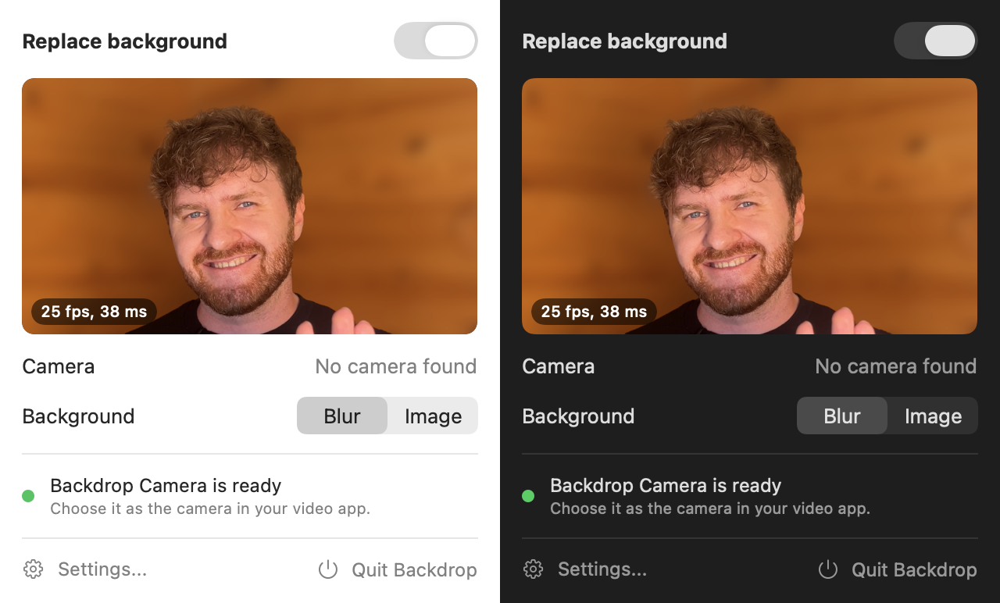

# Backdrop

Background replacement for any camera on macOS, including cameras macOS gives no Background effect for, such as an older iPhone used as a Continuity Camera.

Backdrop lives in the menu bar. It cuts you out of the camera picture with Apple's Vision person segmentation, puts a blur or an image of your choice behind you, and publishes the result as a camera called **Backdrop Camera** that Chrome, Meet, Zoom, FaceTime and other video apps can select.



## Install

1. Download the latest `Backdrop-<version>.zip` from [Releases](../../releases/latest) and unzip it.
2. Move **Backdrop.app** to the **Applications** folder. macOS installs camera extensions only from there.
3. Open Backdrop, click its icon in the menu bar, then **Install**.
4. Allow it in **System Settings > General > Login Items & Extensions > Camera Extensions**.
5. In your video app, choose **Backdrop Camera**. Backdrop must be running for it to show a picture.

Requires macOS 14 or later.

## Use

- **Replace background** switches the effect on or off.
- **Camera** picks the camera Backdrop reads from.
- **Background** is Blur or Image. Click a thumbnail to use it; **+** adds your own image; right-click removes one; the **Blur** slider blurs the image.
- **Settings** has the segmentation quality (Fast, Balanced, Accurate), edge softness, blur strength and Open at login.

Behaviour and wording are specified in [docs/ux.md](docs/ux.md).

## Build from source

Requires Xcode 26 and [XcodeGen](https://github.com/yonaskolb/XcodeGen).

```sh
xcodegen generate
xcodebuild -project Backdrop.xcodeproj -scheme Backdrop -configuration Debug -derivedDataPath build -allowProvisioningUpdates build
```

Camera extensions only load when signed with a team that has the System Extension capability. To build under your own team, change `DEVELOPMENT_TEAM` and the `com.anetrebskii` bundle identifiers in `project.yml`, then copy `build/Build/Products/Debug/Backdrop.app` to `/Applications`.

### Test without a camera

```sh
BACKDROP_FIXTURE=frame.png BACKDROP_LIBRARY=/tmp/backgrounds BACKDROP_ADD=bg1.jpg:bg2.jpg \
  build/Build/Products/Debug/Backdrop.app/Contents/MacOS/Backdrop --snapshot /tmp/shots
```

This feeds a still frame instead of the camera, goes through every panel state and writes panel, settings and output images plus `log.txt` with frame rate and segmentation time.

## Releases

Every push to `main` builds the Release configuration, signs it with Developer ID, notarizes it and publishes a GitHub release (`.github/workflows/release.yml`). The app's Developer ID provisioning profile is in `signing/`. The workflow needs these repository secrets:

- `DEVELOPER_ID_P12` and `DEVELOPER_ID_P12_PASSWORD`: the Developer ID Application certificate with its private key, base64-encoded, and its export password.
- `ASC_KEY_P8`, `ASC_KEY_ID` and `ASC_ISSUER_ID`: an App Store Connect API key for notarization, the `.p8` file base64-encoded.

## How it works

- `App/Pipeline.swift` reads the camera, runs `VNGeneratePersonSegmentationRequest`, and composites the person over the background with Core Image on the GPU at 1920x1080.
- `App/VirtualCameraSink.swift` pushes finished frames into the camera extension's sink stream through CoreMediaIO.
- Backdrop Camera offers 1080p and 720p. Backdrop works at the resolution the video app picks, and at 720p while only the panel preview is open. The person mask is recomputed on every third frame and reused in between.
- `CameraExtension/` is a CoreMediaIO camera extension that forwards those frames to video apps, and shows a dark frame while Backdrop is not running.

## License

MIT
